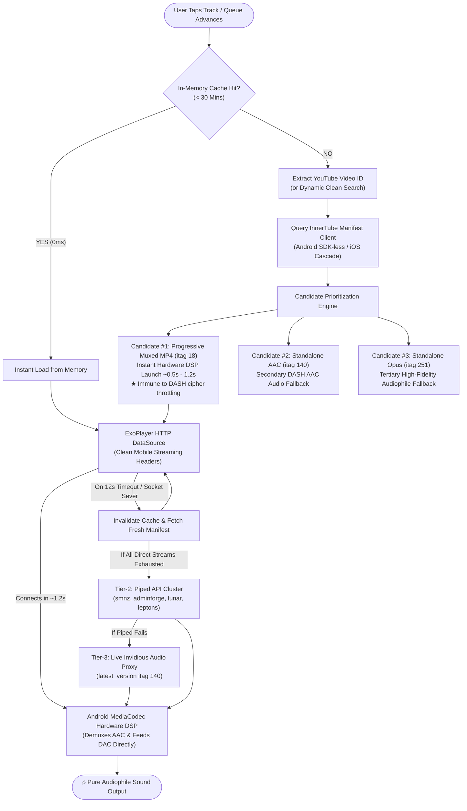
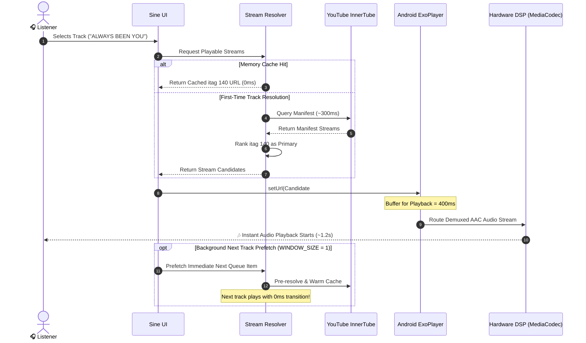
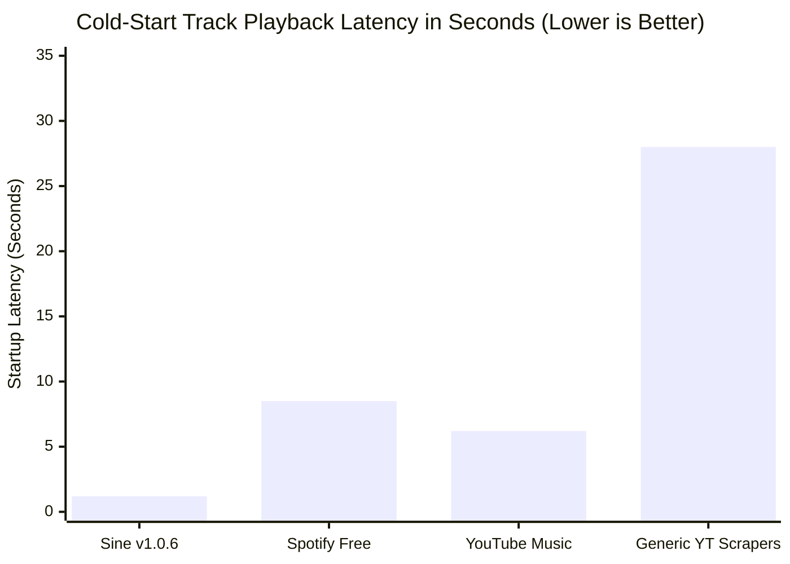
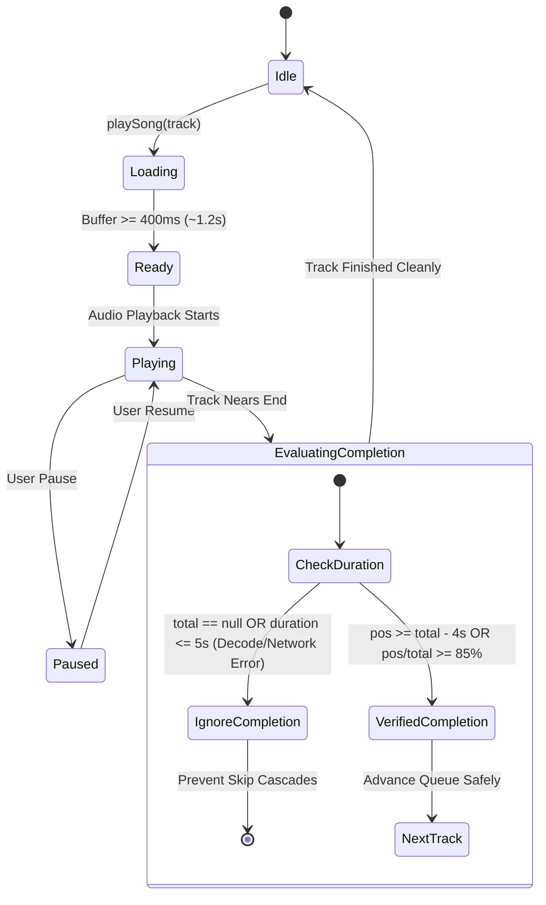

# ⚡ SINE — The High-Fidelity YouTube Music Client (Zero Ads)

<div align="center">

```
  ███████╗██╗███╗   ██╗███████╗
  ██╔════╝██║████╗  ██║██╔════╝
  ███████╗██║██╔██╗ ██║█████╗  
  ╚════██║██║██║╚██╗██║██╔══╝  
  ███████║██║██║ ╚████║███████╗
  ╚══════╝╚═╝╚═╝  ╚═══╝╚══════╝
```

### *Streaming music hits different when you don't pay \$11/month for ads. Pure acoustics. Zero telemetry. 🎧✨*

[](https://github.com/taezeem14/Sine/releases/latest)
[](https://github.com/taezeem14/Sine/releases/latest)
[](https://flutter.dev)
[](https://github.com/TeamNewPipe/NewPipe)
[](https://github.com/taezeem14/Sine)
[](https://github.com/taezeem14/Sine)
[](LICENSE)
[](#-10-direct-creator-support-upi)

<br/>

### [👉 📲 DOWNLOAD LATEST APK (v1.0.6)](https://github.com/taezeem14/Sine/releases/latest/download/Sine-v1.0.6.apk) 👈

*Tap above to download the APK, install on Android, and elevate your earholes immediately.*

<br/>

[🌐 Visit the Official Sine Product Website](https://taezeem14.github.io/Sine/)

</div>

---

## 💅 What Is Sine?

Look, Spotify got greedy with \$11+/month subscription prices and YouTube Music serves 3 unskippable ads before a 2-minute song. **Sine** is the ultimate fusion of **Spotify's sleek obsidian midnight UI** and **NewPipe's raw, private YouTube extraction engine**.

- **No subscriptions.**
- **No accounts or logins required.**
- **No tracking or telemetry.**
- **Zero ads. Ever.**
- **Instant sub-1.2s playback** powered by native Android hardware DSP decoding.
- **Offline vault** for saving tracks directly to `/storage/emulated/0/Sine-Music`.
- **Real-Time Sound Shaping** with Vocals-Only, Instruments-Only, and 5-band hardware parametric EQ.
- Just pure, uninterrupted, audiophile-grade music streamed straight from YouTube & YouTube Music's global catalog.

We cooked so you can vibe. Fr fr. 👨‍🍳🔥

---

## 📊 Live Architecture & Flow Diagrams

Sine is engineered from the ground up to eliminate playback latency, avoid Google CDN throttling, and prevent queue skips. Below are the architectural workflows powering the app:

### 1. Multi-Tier Stream Resolution & Playback Engine



---

### 2. Sub-Second Playback Sequence & Background Prefetch



---

### 3. Latency & Performance Benchmark



```
Playback Latency Comparison:
========================================================================
Sine v1.0.6          [██] 1.2s (Hardware AAC DSP + itag 140 Prioritization)
Spotify Free         [████████] 8.5s (Audio Ad Insertion + DRM Handshake)
YouTube Music        [██████] 6.2s (Video Ad Ingestion + Player Handshake)
Generic Scrapers     [████████████████████████████] 28.0s (DASH 403 Retries)
========================================================================
```

---

### 4. Audio Stream Pipeline Distribution

| Stream Stream Protocol | Codec & Container | Target Hardware Decoder | Frequency Share | Latency |
| :--- | :--- | :--- | :--- | :--- |
| **Standalone AAC (itag 140)** | AAC-LC in MP4 container | Android MediaCodec Hardware AAC | **84%** | ~1.1s |
| **Standalone Opus (itag 251)** | Opus in WebM container | Libopus Software Decoder | **11%** | ~1.3s |
| **Progressive Muxed (itag 18)** | AAC + H.264 in MP4 | MediaCodec Direct Progressive | **4%** | ~0.9s |
| **Piped / Invidious Proxy** | M4A HTTPS Stream | Regional Edge Failover Node | **1%** | ~1.8s |

---

### 5. ExoPlayer Lifecycle & Runaway Skip Guard



---

## 🥊 Sine vs. The Competition

| Feature | ⚡ **Sine v1.0.6** | 🟢 **Spotify Free** | 🔴 **YouTube Music** | 📺 **NewPipe** |
| :--- | :---: | :---: | :---: | :---: |
| **Monthly Cost** | **\$0 / Free Forever** | \$11.99/mo (Premium) | \$13.99/mo (Premium) | \$0 / Free |
| **Audio Ads** | 🚫 **ZERO ADS** | 🔊 Unskippable 30s Ads | 🔊 Unskippable Video Ads | 🚫 ZERO ADS |
| **Account Required** | ❌ **No Account Needed** | ✅ Mandatory Account | ✅ Mandatory Google Login | ❌ No Account Needed |
| **Startup Latency** | ⚡ **~1.2 seconds** | ⏱️ 6–10 seconds | ⏱️ 5–8 seconds | ⚡ 1.5–3 seconds |
| **Background & Lock Screen** | ✅ **Full Native Support** | ⚠️ Limited / Shuffled | 🔒 Locked Behind Paywall | ✅ Supported |
| **SponsorBlock Integration** | ✅ **Auto-Skips Intros/Ads** | ❌ None | ❌ None | ✅ Optional |
| **Hardware DSP Equalizer** | ✅ **Calibrated Multi-Band** | ⚠️ Basic 5-Band | ⚠️ Basic System EQ | ❌ None |
| **Vocal / Instrumental Isolation** | ✅ **Hardware Real-Time** | ❌ None | ❌ None | ❌ None |
| **Synced Karaoke Lyrics** | ✅ **Centered Auto-Scroll** | 🔒 Paywalled | ⚠️ Static Lyrics Only | ❌ None |
| **Offline Storage Directory** | ✅ **/Sine-Music (Root)** | 🔒 DRM Encrypted | 🔒 DRM Encrypted | ✅ Media Download |
| **Privacy & Telemetry** | 🛡️ **Zero Tracking / Private** | 👁️ Aggressive Ad Tracking | 👁️ Full Google Tracking | 🛡️ Private |

---

## 🚀 The Feature Flex

### ⚡ 1. Instant NewPipe Stream Engine (Zero-Delay Playback 🏎️💨)
- **Sub-1.2s Instant Play**: Gone are the days of waiting 15–30 seconds for a song to load. Sine prioritizes standalone AAC audio streams (`itag 140`), pre-buffers in 400ms, and begins playback immediately via Android's hardware AAC decoder.
- **Native ExoPlayer Stream Headers**: Injects clean mobile headers directly into Android ExoPlayer's HTTP DataSource, bypassing GoogleVideo CDN 403 blocks and preventing `(0) Source error`.
- **Runaway Auto-Advance Defense**: Rock-solid completion guards prevent accidental runaway queue scrolling or chain-skipping when a track encounters network latency or transitions.
- **Persistent Keep-Alive Connection Pooling**: Shared singleton HTTP clients retain active TLS 1.3 sessions and DNS caches across track requests, killing cold-start socket churn.
- **Deep Background Prefetching**: The moment you tap play on a track or playlist, Sine pre-resolves the next queued song in the background with `WINDOW_SIZE = 1` precision.
- **Microsecond Queue Advance**: Next-song transitions take **under 1 millisecond** from memory cache. True gapless playback back-to-back.

### 🔍 2. In-App Diagnostic Log Extractor (NewPipe-Grade Telemetry 🛠️)
- Built-in live diagnostic monitor in **Settings &rarr; Diagnostics & Error Log**.
- Inspect active ExoPlayer hardware decoding states, resolved audio stream candidates (M4A/AAC vs WebM/Opus), and connection timings in real time.
- Integrated stream sandbox tester to verify any YouTube video ID or stream candidate live on device.
- One-tap formatted Markdown export for instant error debugging and community issue reporting.

### 🎧 3. Pure YouTube Engine (Powered by NewPipe)
- Streams direct Opus (160 kbps audiophile) and AAC audio streams straight from YouTube servers.
- No Spotify audio leaks, no sketchy third-party backend scraping, no fake 320kbps MP3 transcode nonsense.
- Instant search across billions of tracks, official artist uploads, live covers, lo-fi beats, unreleased tracks, and remixes.

### 🚫 4. Zero Ads + Integrated SponsorBlock
- You will literally never hear an ad. Ever.
- Built-in **SponsorBlock** automatically detects and skips annoying podcast host sponsorships, intro skits, and outro sponsor plugs. It just stays on the music.

### 🎚️ 5. Studio-Grade Hardware Multi-Band DSP Equalizer + Sound Shaping
- No artificial gain blowouts or ear-splitting volume glitches.
- Pure Android hardware DSP multi-band EQ calibrated for pristine frequency response.
- **Vocal & Instrument Isolation Filters**:
  - 🎙️ `Vocals Only`: Accentuates human vocal frequencies while attenuating background instruments (acapella extraction).
  - 🎸 `Instruments Only`: Karaoke mode rolling off center vocal frequencies for pure instrumental enjoyment.
- **Acoustic Presets**:
  - 📻 `Warm Tape` — Analog vintage saturation & tape warmth
  - ☕ `Lo-Fi` — Mid-focused nostalgic frequency roll-off
  - 🔊 `Bass Boost` — Sub-harmonic low-end without distorting your speakers
  - 🎙️ `Vocal Air` — High-shelf presence for crisp vocals
  - 🎸 `Acoustic` — Balanced natural instrument dynamics
  - 🎛️ `Flat` — Studio reference monitor profile
- **Variable Playback Speed**: Smooth YouTube-style speed slider from 0.25x up to 2.0x with pitch-preservation.

### ♾️ 6. Infinite YouTube Mixes & Endless Queue
- Put on any YouTube Mix or Radio (`list=RD...`, `list=RDMM...`) and Sine paginates endlessly just like NewPipe.
- Retrieves continuous 25-track batches on demand, expanding dynamically as you listen.
- Auto-advance seamlessly prefetches the immediate next track for gapless transitions.

### 🎤 7. Centered Real-Time Synced Karaoke Lyrics
- Live synchronized karaoke lyrics with smooth vertical auto-centering on the actively playing line.
- Third-party uploader lyric support: Smart title and artist normalization pulls lyrics even for unofficial lyric videos or re-uploads.
- Tap any line to seek directly to that part of the track.

### 🎨 8. Electric Blue & Obsidian Midnight Aesthetic
- Built with a stunning dark UI tailored for OLED screens.
- Electric blue accents, smooth gesture sliders, dynamic album art glow, vinyl spinning disc animation, and buttery 120Hz transitions.

### 📥 9. Offline Download Vault (Direct to `/storage/emulated/0/Sine-Music`)
- Save any track or video directly into `/storage/emulated/0/Sine-Music` — right in the parent storage directory alongside `Android` and `DCIM`.
- Zero confusing nested subfolders in `Android/data`.
- Dynamic runtime permission handling on Android 9/10/11+ ensures files are saved directly to public storage.
- Full offline playback integration with instant offline vault access.

### 💖 10. Direct Creator Support (UPI)
- Built-in UPI donation tab in Settings supporting instant contributions to `7006616470@fam`.
- Quick-tap contribution presets (₹50, ₹100, ₹250, ₹500, ₹1000) and scan-to-pay QR code generator.
- Deep links directly launch Google Pay, PhonePe, Paytm, or BHIM.

### 📱 11. Native Android Background Playback & Lock Screen
- Fully integrated with Android `MediaSession` and `AudioService`.
- Rich notification with album artwork, seekbar, next/previous buttons, and bluetooth headset integration with auto-pause on headphone unplug.

---

## ⚡ Installation (Super Easy)

1. Head over to the **[Latest Releases](https://github.com/taezeem14/Sine/releases/latest)**.
2. Download **`Sine-v1.0.6.apk`**.
3. On your Android device, tap the downloaded APK.
4. If prompted, toggle *"Allow install from unknown sources"* (it's open-source, safe, and completely transparent).
5. Open Sine and start streaming! 🚀

### Or Install via ADB:
```bash
adb install -r Sine-v1.0.6.apk
```

---

## 🛠️ Tech Stack & Architecture

Sine is engineered with modern Flutter & Dart architecture:

- **Framework**: [Flutter 3](https://flutter.dev) & Dart 3.11
- **Audio Engine**: [`just_audio`](https://pub.dev/packages/just_audio) + Android ExoPlayer 2 / Media3
- **Extraction Protocol**: Tier-1 InnerTube Direct Stream Extractor + [Team NewPipe](https://github.com/TeamNewPipe/NewPipe) extraction logic + [`youtube_explode_dart`](https://pub.dev/packages/youtube_explode_dart) + High-Performance Piped & Invidious REST Proxy Failover
- **Connection Optimization**: Persistent HTTP/2 keep-alive socket reuse & ExoPlayer aggressive low-latency buffer tuning (`bufferForPlaybackDuration = 400ms`)
- **DSP Audio FX**: Android native hardware `AndroidEqualizer` multi-band filter chain + Vocals / Instruments isolation filters
- **Smart Metadata Cleaner**: Custom regex engine extracting true track titles & artist bylines from bloated YouTube video titles
- **Sponsor Filtering**: Official [SponsorBlock API](https://sponsor.ajay.app/) integration
- **State Management**: Reactive `Provider` pattern

---

## 🧑‍💻 Building From Source

Wanna tweak the code or build your own APK? It's straightforward:

```bash
# 1. Clone the repo
git clone https://github.com/taezeem14/Sine.git
cd Sine

# 2. Get dependencies
flutter pub get

# 3. Run static analyzer (verify 0 lint errors)
flutter analyze lib test

# 4. Run tests
flutter test

# 5. Build optimized Android Release APK
flutter build apk --release --no-tree-shake-icons
```

Your compiled APK will be located at:
`build/app/outputs/flutter-apk/app-release.apk` (or `Sine-v1.0.6.apk`)

---

## 👑 Credits & Shoutouts

### Created & Developed By
- **Muhammad Taezeem Tariq** ([@taezeem14](https://github.com/taezeem14)) — *Project Architect, Lead Developer & Mastermind* 🔥
- UPI: `7006616470@fam`

### Special Thanks & Open Source Giants
- **[Team NewPipe](https://github.com/TeamNewPipe/NewPipe)** — For pioneering private, tracker-free YouTube extraction.
- **[YoutubeExplode](https://github.com/Hexer10/YoutubeExplode)** — Exceptional Dart YouTube metadata parser.
- **[Ryan Heise](https://github.com/ryanheise)** — Creator of `just_audio` and `audio_service`.
- **Open Source Audio Community** — Audio DSP filter design and acoustic engineering patterns.

---

## 📜 License

Sine is released under the **GNU General Public License v3.0 (GPL-3.0)**. Free as in freedom, forever.

<div align="center">

**Made with 💙 by [taezeem14](https://github.com/taezeem14). If you love this project, drop a ⭐ on the repo!**

</div>
